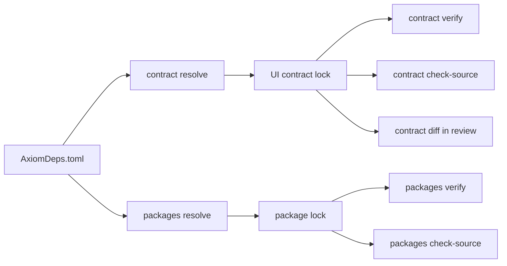

These commands manage what a frontend depends on (contract locks, typed
frontend packages, and third-party packages for authored extensions) and
analyze a backend contract's optional domain and security layers. This page
covers Axiom CLI 0.149.1. None of them needs a Cloud login; only
`dependencies resolve` and `dependencies cache recover` contact package
registries over the network.

| Group | Use it to | Status |
| --- | --- | --- |
| [`axiom contract`](#axiom-contract) | Lock and verify the backend contracts a frontend imports. | Alpha |
| [`axiom packages`](#axiom-packages) | Build, lock, verify and review typed frontend `.axiom` packages. | Alpha |
| [`axiom dependencies`](#axiom-dependencies) | Resolve and audit third-party packages used by authored extensions. | Experimental |
| [`axiom domain`](#axiom-domain) | Validate the Domain Model v1 layer, or bootstrap it from OpenAPI or SQL. | Alpha (`validate`), Experimental (`bootstrap`) |
| [`axiom security`](#axiom-security) | Analyze the opt-in Security Model v1 layer without building. | Alpha, as part of the Acore contract toolchain |

Axiom Marketplace is **Coming soon**. The `packages` commands do not discover
or install packages from a catalog; they consume explicit package files and
locks.



`AxiomDeps.toml` declares the contracts and packages a frontend uses.
`contract resolve` and `packages resolve` turn it into deterministic locks under
`.axiom/`. In CI, `verify` re-resolves the manifest and fails if the committed
lock differs, `check-source` validates imports against the lock alone, and the
`diff` commands show semantic changes for review.

## axiom contract

Resolves and verifies the signed backend contract artifacts that a frontend
imports with `use contract`, and records them in a deterministic UI contract
lock. Normal development through `axiom run FRONTEND.acore` discovers the
manifest and maintains an internal development lock under `.axiom/dev`
automatically. Use these commands to manage a reviewed lock for CI and release
workflows.

```text title="Usage"
axiom contract <COMMAND>
```

No options other than `--help`.

| Command | Purpose |
| --- | --- |
| [`contract resolve`](#axiom-contract-resolve) | Resolve manifest entries, show changes and write the lock. |
| [`contract verify`](#axiom-contract-verify) | Re-resolve and verify locked bytes and proof without changing files. |
| [`contract diff`](#axiom-contract-diff) | Show semantic changes between two locks. |
| [`contract facade`](#axiom-contract-facade) | Print read-only virtual-facade metadata for a locked alias. |
| [`contract check-source`](#axiom-contract-check-source) | Validate `use contract` declarations against the committed lock. |

A frontend manifest names each contract alias, its artifact and the operations
it uses. This is the task-app example:

```toml title="frontend/AxiomDeps.toml"
type = "frontend"
targets = ["web"]

[contracts.tasks]
artifact = "../backend/.axiom/contracts/backend.axiom"
baseUrl = "http://127.0.0.1:8080"
audience = "web"
operations = ["create_task", "delete_task", "list_tasks", "update_task"]
```

An entry that points at an unsigned local artifact produces a warning: it is
allowed for development, and you release the contract through Axiom Cloud
before production use.

### axiom contract resolve

Resolves the contract entries in `AxiomDeps.toml` into a deterministic lock.
When the lock already exists and changes, it prints the semantic diff as JSON
before writing. It reads only the local artifacts the manifest names. With the
default `--lock`, the lock path is relative to the manifest's directory.

```text title="Usage"
axiom contract resolve [OPTIONS]
```

| Option | Value | Default | Meaning |
| --- | --- | --- | --- |
| `--deps` | file | `AxiomDeps.toml` | Dependency manifest to resolve. |
| `--lock` | file | `.axiom/axiom.ui.lock.json` | Lock file to write. |

```bash title="Terminal"
axiom contract resolve
```

### axiom contract verify

Re-resolves the manifest and checks every locked input, byte for byte, without
changing files. Use it in CI. On a mismatch it fails and asks you to resolve and
review the semantic diff. On success it reports how many aliases are signed and
unsigned.

```text title="Usage"
axiom contract verify [OPTIONS]
```

| Option | Value | Default | Meaning |
| --- | --- | --- | --- |
| `--deps` | file | `AxiomDeps.toml` | Dependency manifest. |
| `--lock` | file | `.axiom/axiom.ui.lock.json` | Lock file to verify, relative to the manifest's directory by default. |

```bash title="Terminal"
axiom contract verify
```

### axiom contract diff

Prints the semantic changes between two UI contract locks as JSON. Use it to
review a lock update.

```text title="Usage"
axiom contract diff <BEFORE> <AFTER>
```

| Option | Value | Default | Meaning |
| --- | --- | --- | --- |
| `<BEFORE>` | lock file | required | Earlier lock. |
| `<AFTER>` | lock file | required | Later lock. |

### axiom contract facade

Prints read-only virtual-facade metadata for one locked alias: the typed
interface the UI compiler derives for that contract. No facade file is
generated.

```text title="Usage"
axiom contract facade [OPTIONS] <ALIAS>
```

| Option | Value | Default | Meaning |
| --- | --- | --- | --- |
| `<ALIAS>` | name | required | Contract alias from the lock, such as `tasks`. |
| `--lock` | file | `.axiom/axiom.ui.lock.json` | Lock to read. |

### axiom contract check-source

Validates the `use contract` declarations in one source file against only the
committed lock. It never resolves or writes files, and exits non-zero with one
diagnostic per problem.

```text title="Usage"
axiom contract check-source [OPTIONS] <SOURCE>
```

| Option | Value | Default | Meaning |
| --- | --- | --- | --- |
| `<SOURCE>` | `.acore` file | required | Frontend source to validate. |
| `--lock` | file | `.axiom/axiom.ui.lock.json` | Committed lock. |

```bash title="Terminal"
axiom contract check-source main.acore
```

## axiom packages

Builds, resolves, verifies, inspects, diffs and source-checks typed frontend
`.axiom` packages, such as theme and component libraries. Resolution reads only
local files inside the manifest's directory, and rejects an artifact that
resolves outside it. See [Packages](/extensions/packages).

```text title="Usage"
axiom packages <COMMAND>
```

No options other than `--help`.

| Command | Purpose |
| --- | --- |
| [`packages build`](#axiom-packages-build) | Validate and canonically encode a package envelope. |
| [`packages resolve`](#axiom-packages-resolve) | Resolve package dependencies into the package lock. |
| [`packages verify`](#axiom-packages-verify) | Re-resolve locked bytes and proofs. |
| [`packages inspect`](#axiom-packages-inspect) | Print one verified locked envelope. |
| [`packages diff`](#axiom-packages-diff) | Classify package changes and enforce explicit approvals. |
| [`packages check-source`](#axiom-packages-check-source) | Validate imports and compile the unchanged source for a target. |
| [`packages run`](#axiom-packages-run) | Run package-backed source through the normal target session. |

### axiom packages build

Validates a typed package envelope, writes its canonical encoding to `--out`,
and prints the output path and SHA-256 digest.

```text title="Usage"
axiom packages build --out <OUT> <SOURCE>
```

| Option | Value | Default | Meaning |
| --- | --- | --- | --- |
| `<SOURCE>` | JSON file | required | Package envelope to encode. |
| `-o, --out` | file | required | Encoded `.axiom` package to write. |

### axiom packages resolve

Resolves the package entries in `AxiomDeps.toml` into a canonical lock that you
commit. It validates the complete lock before replacing any output.

```text title="Usage"
axiom packages resolve [OPTIONS]
```

| Option | Value | Default | Meaning |
| --- | --- | --- | --- |
| `--deps` | file | `AxiomDeps.toml` | Dependency manifest. |
| `--lock` | file | `.axiom/AxiomPackages.lock` | Package lock to write. |

```bash title="Terminal"
axiom packages resolve
```

### axiom packages verify

Re-resolves the manifest and verifies every locked package's bytes and proofs
without changing files. Use it in CI.

```text title="Usage"
axiom packages verify [OPTIONS]
```

| Option | Value | Default | Meaning |
| --- | --- | --- | --- |
| `--deps` | file | `AxiomDeps.toml` | Dependency manifest. |
| `--lock` | file | `.axiom/AxiomPackages.lock` | Package lock to verify. |

```bash title="Terminal"
axiom packages verify
```

### axiom packages inspect

Prints one verified locked package envelope as JSON.

```text title="Usage"
axiom packages inspect [OPTIONS] <ALIAS>
```

| Option | Value | Default | Meaning |
| --- | --- | --- | --- |
| `<ALIAS>` | name | required | Package alias from the lock. |
| `--lock` | file | `.axiom/AxiomPackages.lock` | Package lock to read. |

### axiom packages diff

Prints a semantic diff of two encoded packages as JSON, then fails unless every
change that needs review is approved. Approval values are `breaking-change`,
`target-reduction`, `new-required-theme-role` and `permission-increase`.

```text title="Usage"
axiom packages diff [OPTIONS] <BEFORE> <AFTER>
```

| Option | Value | Default | Meaning |
| --- | --- | --- | --- |
| `<BEFORE>` | `.axiom` package | required | Earlier package. |
| `<AFTER>` | `.axiom` package | required | Later package. |
| `--approve` | approval | none | Approve one change class. Repeat for several. |

```bash title="Terminal"
axiom packages diff theme-1.0.0.axiom theme-2.0.0.axiom --approve breaking-change
```

### axiom packages check-source

Validates package imports against the package lock and compiles the unchanged
source for one target. It writes no files and exits non-zero on a diagnostic.

```text title="Usage"
axiom packages check-source [OPTIONS] <SOURCE>
```

| Option | Value | Default | Meaning |
| --- | --- | --- | --- |
| `<SOURCE>` | `.acore` file | required | Package-backed UI source. |
| `--package-lock` | file | `.axiom/AxiomPackages.lock` | Package lock. |
| `--ui-lock` | file | `.axiom/axiom.ui.lock.json` | UI contract lock. |
| `--target` | `web`, `android`, `ios` | `ios` | Target to compile for. |

### axiom packages run

Runs package-backed source through the normal target host session, like
[`axiom ui run`](/tooling/cli-ui#axiom-ui-run) with a package lock. Host and
Node.js requirements are the same as for `ui run`.

```text title="Usage"
axiom packages run [OPTIONS] <SOURCE>
```

| Option | Value | Default | Meaning |
| --- | --- | --- | --- |
| `<SOURCE>` | `.acore` file | required | Package-backed UI source. |
| `--package-lock` | file | `.axiom/AxiomPackages.lock` | Package lock. |
| `--ui-lock` | file | `.axiom/axiom.ui.lock.json` | UI contract lock. |
| `--target` | `web`, `android`, `ios` | `ios` | Target to run. |
| `--once` | flag | off | Compile once and exit. |
| `--launch` | flag | off | Open the browser or deliver to the native host. Cannot be combined with `--once`. |

## axiom dependencies

Resolves and audits third-party packages that authored executable extensions
use. The manifest is `AxiomDeps.toml` in its strict v2 schema, which declares
registries and build environments. Resolution writes the canonical lock
`.axiom/AxiomDeps.lock`, stores artifacts in an immutable content-addressed
cache, and materializes a workspace view. Package scripts and advisories are
recorded, never executed. Executable extensions are **Experimental**; see
[Extension dependencies](/extensions/dependencies).

```text title="Usage"
axiom dependencies <COMMAND>
```

No options other than `--help`.

| Command | Purpose |
| --- | --- |
| [`dependencies check`](#axiom-dependencies-check) | Validate the v2 manifest without fetching. |
| [`dependencies format`](#axiom-dependencies-format) | Canonically format the manifest. |
| [`dependencies migrate`](#axiom-dependencies-migrate) | Convert a v1 manifest to v2. |
| [`dependencies schema`](#axiom-dependencies-schema) | Print the v2 JSON Schema. |
| [`dependencies completions`](#axiom-dependencies-completions) | Return editor completions for a TOML path. |
| [`dependencies hover`](#axiom-dependencies-hover) | Explain one manifest field. |
| [`dependencies resolve`](#axiom-dependencies-resolve) | Resolve package graphs and write the lock. |
| [`dependencies verify`](#axiom-dependencies-verify) | Validate the lock and every cached byte. |
| [`dependencies inspect`](#axiom-dependencies-inspect) | Explain environments, provenance, licenses, advisories and scripts. |
| [`dependencies cache`](#axiom-dependencies-cache) | Verify, prune or recover the cache. |

When `--cache` is omitted, the cache is `axiom/dependencies/v1` inside the user
cache directory.

### axiom dependencies check

Validates the complete `AxiomDeps.toml` v2 document without fetching anything.
It prints the canonical manifest digest and the number of contracts, packages,
extensions and build environments, and exits non-zero on the first problem.

```text title="Usage"
axiom dependencies check [OPTIONS]
```

| Option | Value | Default | Meaning |
| --- | --- | --- | --- |
| `--deps` | file | `AxiomDeps.toml` | Manifest to validate. |
| `--json` | flag | off | Print the result or diagnostics as JSON. |

```bash title="Terminal"
axiom dependencies check
```

### axiom dependencies format

Canonically formats a v2 manifest. By default it prints the formatted manifest
to standard output.

```text title="Usage"
axiom dependencies format [OPTIONS]
```

| Option | Value | Default | Meaning |
| --- | --- | --- | --- |
| `--deps` | file | `AxiomDeps.toml` | Manifest to format. |
| `--check` | flag | off | Fail if formatting would change the file. Cannot be combined with `--write`. |
| `--write` | flag | off | Replace the manifest after successful validation. |

### axiom dependencies migrate

Converts a supported v1 manifest to the strict v2 schema in memory. By default
it prints the result to standard output.

```text title="Usage"
axiom dependencies migrate [OPTIONS]
```

| Option | Value | Default | Meaning |
| --- | --- | --- | --- |
| `--deps` | file | `AxiomDeps.toml` | v1 manifest to convert. |
| `--out` | file | none | Write the migrated manifest to a new file. Cannot be combined with `--write`. |
| `--write` | flag | off | Replace the input after a successful migration. |

### axiom dependencies schema

Prints the checked-in `AxiomDeps.toml` v2 JSON Schema, for editors and
validation tools.

```text title="Usage"
axiom dependencies schema
```

No options other than `--help`.

### axiom dependencies completions

Returns deterministic editor completion candidates for a position in the
manifest, given as a TOML path.

```text title="Usage"
axiom dependencies completions [OPTIONS]
```

| Option | Value | Default | Meaning |
| --- | --- | --- | --- |
| `--path` | TOML path | empty (the document root) | Path to complete. |
| `--json` | flag | off | Print JSON. |

### axiom dependencies hover

Explains one `AxiomDeps.toml` v2 field. It fails when the path has no
documentation.

```text title="Usage"
axiom dependencies hover [OPTIONS] <PATH>
```

| Option | Value | Default | Meaning |
| --- | --- | --- | --- |
| `<PATH>` | TOML path | required | Field to explain. |
| `--json` | flag | off | Print JSON. |

### axiom dependencies resolve

Resolves exact package graphs from the registries the manifest declares,
verifies and stores every artifact in the cache, writes the canonical lock and
materializes the workspace view. It needs network access to those registries
unless you pass `--locked` or `--offline`. Direct exact-version conflicts are
rejected before any network request.

```text title="Usage"
axiom dependencies resolve [OPTIONS]
```

| Option | Value | Default | Meaning |
| --- | --- | --- | --- |
| `--deps` | file | `AxiomDeps.toml` | Manifest to resolve. |
| `--lock` | file | `.axiom/AxiomDeps.lock` | Canonical lock to write. |
| `--cache` | directory | user cache `axiom/dependencies/v1` | Content-addressed cache. |
| `--workspace-view` | directory | `.axiom/dependencies` | Where locked artifacts are materialized for the workspace. |
| `--locked` | flag | off | Require the existing lock and cache; never resolve or fetch. Cannot be combined with `--offline`. |
| `--offline` | flag | off | Reuse the existing lock and cache without network access. |
| `--json` | flag | off | Print a JSON summary. |

With `--locked` or `--offline`, the lock must match the current manifest and
the cache must hold every locked artifact.

```bash title="Terminal"
axiom dependencies resolve
axiom dependencies resolve --locked
```

### axiom dependencies verify

Validates the canonical lock and every cached byte it references, offline. It
fails on a corrupt or malformed cache object. Use it in CI.

```text title="Usage"
axiom dependencies verify [OPTIONS]
```

| Option | Value | Default | Meaning |
| --- | --- | --- | --- |
| `--lock` | file | `.axiom/AxiomDeps.lock` | Lock to verify. |
| `--cache` | directory | user cache `axiom/dependencies/v1` | Cache to check. |
| `--json` | flag | off | Print JSON. |

```bash title="Terminal"
axiom dependencies verify
```

### axiom dependencies inspect

Explains the environments, provenance, licenses, advisories and package scripts
recorded in the lock.

```text title="Usage"
axiom dependencies inspect [OPTIONS]
```

| Option | Value | Default | Meaning |
| --- | --- | --- | --- |
| `--lock` | file | `.axiom/AxiomDeps.lock` | Lock to explain. |
| `--json` | flag | off | Print the complete lock as JSON. |

### axiom dependencies cache

Verifies, prunes or recovers the immutable authored-dependency cache.

```text title="Usage"
axiom dependencies cache <COMMAND>
```

No options other than `--help`. The subcommands are `verify`, `prune` and
`recover`.

### axiom dependencies cache verify

Checks every object in the cache against its digest and exits non-zero when any
object is corrupt or malformed.

```text title="Usage"
axiom dependencies cache verify [OPTIONS]
```

| Option | Value | Default | Meaning |
| --- | --- | --- | --- |
| `--cache` | directory | user cache `axiom/dependencies/v1` | Cache to verify. |
| `--json` | flag | off | Print JSON. |

### axiom dependencies cache prune

Removes cache objects that none of the given locks reference. It requires at
least one `--lock`; there is no implicit global deletion.

```text title="Usage"
axiom dependencies cache prune [OPTIONS] --lock <LOCKS>
```

| Option | Value | Default | Meaning |
| --- | --- | --- | --- |
| `--cache` | directory | user cache `axiom/dependencies/v1` | Cache to prune. |
| `--lock` | file | required | Canonical lock whose objects are retained. Repeat for several locks. |
| `--json` | flag | off | Print JSON. |

### axiom dependencies cache recover

Downloads the cache objects a lock needs from their recorded registries and
verifies them. It needs network access.

```text title="Usage"
axiom dependencies cache recover [OPTIONS]
```

| Option | Value | Default | Meaning |
| --- | --- | --- | --- |
| `--lock` | file | `.axiom/AxiomDeps.lock` | Lock whose objects to recover. |
| `--cache` | directory | user cache `axiom/dependencies/v1` | Cache to fill. |
| `--json` | flag | off | Print JSON. |

## axiom domain

Validates or bootstraps the optional Domain Model v1 layer of a backend
contract. See [Domain and security models](/acore-language/domain-and-security-models).

```text title="Usage"
axiom domain <COMMAND>
```

No options other than `--help`.

| Command | Purpose |
| --- | --- |
| [`domain validate`](#axiom-domain-validate) | Validate domain references and print the canonical manifest hash. |
| [`domain bootstrap`](#axiom-domain-bootstrap) | Write reviewable domain suggestions from OpenAPI or SQL. |

### axiom domain validate

Validates domain references and prints the canonical domain manifest hash with
the number of entities, relationships and projections. A contract without a
domain block is reported as such and the command succeeds.

```text title="Usage"
axiom domain validate [OPTIONS] [FILE]
```

| Option | Value | Default | Meaning |
| --- | --- | --- | --- |
| `[FILE]` | `.acore` file | `axiom.acore` | Contract to validate. |
| `--json` | flag | off | Print JSON. |

```bash title="Terminal"
axiom domain validate main.acore --json
```

For the `hello-api` example, which declares no domain block, the output is:

```json title="Expected output"
{
  "format": "none",
  "message": "No optional domain block is declared."
}
```

### axiom domain bootstrap

Writes a reviewable Domain Model v1 block from OpenAPI JSON or exported SQL DDL.
It writes suggestions only: it never modifies the input or your contract and
never connects to a live database. It refuses to overwrite an existing output
file, and the input limit is 8 MiB. Review model names, ownership, audiences and
invariants before you copy the block into `axiom.acore`. OpenAPI and SQL input
is **Experimental** and bounded; it is not full behavior or runtime parity. See
[Existing database](/guides/existing-database).

```text title="Usage"
axiom domain bootstrap [OPTIONS] --source <SOURCE> <INPUT>
```

| Option | Value | Default | Meaning |
| --- | --- | --- | --- |
| `<INPUT>` | file | required | OpenAPI JSON document or exported SQL DDL. |
| `--source` | `openapi`, `sql` | required | Input kind. |
| `--output` | file | `axiom.domain.acore` | New file for the suggestions. |

```bash title="Terminal"
axiom domain bootstrap openapi.json --source openapi
```

## axiom security

Inspects the opt-in Security Model v1 policy, its source evidence and its
coverage. See [Domain and security models](/acore-language/domain-and-security-models)
and [Security rules](/reference/security-rules).

```text title="Usage"
axiom security <COMMAND>
```

No options other than `--help`. The only subcommand is `check`.

### axiom security check

Runs the same deterministic security analysis as `axiom build` without writing
an artifact. It renders the manifest a build embeds: mode, findings, coverage,
policy graph, source evidence and canonical hash. Run it locally, in CI and
before a release. It does not read secret values.

```text title="Usage"
axiom security check [OPTIONS] [FILE]
```

| Option | Value | Default | Meaning |
| --- | --- | --- | --- |
| `[FILE]` | `.acore` file | `axiom.acore` | Contract to analyze. |
| `--json` | flag | off | Print the full report as JSON, suitable for CI annotations. |
| `--fail-on-warning` | flag | off | Return non-zero when there are warnings, for a review-only CI job. |

```bash title="Terminal"
axiom security check axiom.acore
axiom security check axiom.acore --json > security-report.json
axiom build axiom.acore --out backend.axiom
```

For the `hello-api` example with `security(mode: "audit")` added, the report
lists one warning and the command exits with status 0:

```text title="Expected output"
Security Mode audit · 0 error(s), 1 warning(s) · 0 of 1 endpoints covered (0 direct, 0 default-policy)
AXSEC-001 WARNING [hello] `hello` is externally reachable but has no explicit public declaration or authorization policy.
  → Declare `security.endpoints[endpoint]` as public or bind it to a user-defined policy.
```

<span id="exit-behavior" />

#### Exit status

| Situation | Result |
| --- | --- |
| No `security` block | Exits 0 and explains that Security Mode is not enabled. |
| `audit` mode | Exits 0 after reporting findings, including errors that would block strict mode. This makes baseline adoption safe. |
| `strict` mode with error findings | Exits non-zero. `axiom build` uses the same rule. |
| `--fail-on-warning` with warnings | Exits non-zero, so CI can enforce warnings once a team agrees on its baseline. |
| Invalid Acore or invalid policy references | Always exits non-zero. |

#### Recommended rollout

1. Run a Go or Python extractor and review its advisory facts.
2. Add `security(mode: "audit")`, explicit public routes and policies.
3. Classify sensitive fields and add response projections.
4. Declare network, upload, path, process, cache, CORS and logging controls only
   for boundaries the service actually owns.
5. Review each security change in a native contract pull request.
6. Move to `strict` after a trusted server adapter enforces the declarations.

Put policy-safe identifiers such as origins and issuers in Acore, and keep
credentials in deployment secrets. See
[Production readiness](/delivery/production-readiness) for the release review.
