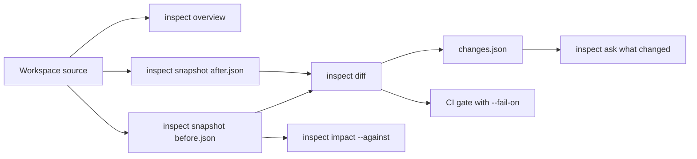

`axiom inspect` turns a frontend, backend or combined workspace into canonical
application evidence: a graph of semantic facts, relationships and the source or
artifact evidence behind them. This page lists every subcommand in CLI 0.149.1.

<StatusNote status="alpha" title="Axiom Inspector is Alpha">
  Inspector commands and output schemas are versioned but pre-stable. The
  optional Jev question planner is **Experimental**. Run `axiom inspect --help`
  and `axiom inspect COMMAND --help` for the installed version.
</StatusNote>

Every subcommand runs locally. None needs Cloud login or network access, except
the opt-in Jev planner used by [`ask`](#axiom-inspect-ask) and
[`serve`](#axiom-inspect-serve). For guided workflows, start with
[Axiom Inspector](/inspector).



The diagram shows a common review loop. You summarize the workspace with
`overview`, write a snapshot before and after a change, compare them with
`diff`, and fail CI on the change classes you choose. The `diff` report also
feeds `ask "what changed"`, and `impact` measures how far one fact's change
reaches against the baseline snapshot.

## axiom inspect

Inspect a workspace, a contract artifact or a packaged application. Without a
subcommand, the command picks a view from the input type.

```text title="Usage"
axiom inspect [PATH] [COMMAND]
```

| Option | Value | Default | Meaning |
| --- | --- | --- | --- |
| `[PATH]` | path | `backend.axiom` | Artifact or source path. Omit it when you use a subcommand, which takes its own path. When omitted without a subcommand, the CLI looks for `backend.axiom`, then legacy `axiom.axiom` or `.axiom`, in the current directory. |

| Input | Result |
| --- | --- |
| Directory or `.acore` source | The same human summary as `axiom inspect overview PATH`. |
| Backend `.axiom` contract | Opens the legacy single-contract terminal inspector. |
| Frontend `.axiom` snapshot | Prints a JSON summary: format, profile, module, targets, page and component counts. |
| Database `.axiom` schema package | Prints the schema package as JSON without connecting to a database. |
| `.axiomapp` application artifact | Verifies the artifact and describes it. |

```bash title="Terminal"
axiom inspect .
axiom inspect api.axiom
axiom inspect dist/my-app-web.axiomapp
```

The legacy terminal inspector has an endpoint view and a model view. The
endpoint pane shows compiled endpoint detail; the model view lists the models
and enums in the artifact. It needs an interactive terminal and fails without
one, for example in CI. In scripts, use `axiom inspect overview` or another
subcommand with `--format json`.

| Key | Action |
| --- | --- |
| `Tab` | Switch between the endpoint and model views. |
| `j` / `k` or arrow keys | Move the current selection. |
| `q` or `Esc` | Exit. |

The screen draws a search field, but text-search input is not part of the
keyboard contract. Do not depend on it for validation. Layout and key hints can
change between CLI versions.

### Subcommands

| Subcommand | Purpose |
| --- | --- |
| [`overview`](#axiom-inspect-overview) | Summarize discovered application facts and verification state. |
| [`source`](#axiom-inspect-source) | Inspect one saved source, manifest or contract file as the editor captures it. |
| [`frontend`](#axiom-inspect-frontend) | Compiler-proven frontend modules, routes, pages and behavior. |
| [`ui`](#axiom-inspect-ui) | Semantic UI tree and its action bindings. |
| [`styles`](#axiom-inspect-styles) | Typed styles, variables and responsive branches. |
| [`state`](#axiom-inspect-state) | State declarations and proven readers and writers. |
| [`accessibility`](#axiom-inspect-accessibility) | Declared accessibility semantics. |
| [`backend`](#axiom-inspect-backend) | Backend services, operations, data and policies. |
| [`operation`](#axiom-inspect-operation) | Trace one operation across contract boundaries. |
| [`data`](#axiom-inspect-data) | Models, fields, projections, relationships and optional lineage. |
| [`exposure`](#axiom-inspect-exposure) | Explicit public and restricted backend exposure facts. |
| [`cache`](#axiom-inspect-cache) | Contract-owned cache policy and operation associations. |
| [`server`](#axiom-inspect-server) | A bound private server plan and optional redacted startup observation. |
| [`dependencies`](#axiom-inspect-dependencies) | Direct and transitive contracts, packages and executable extensions. |
| [`contract`](#axiom-inspect-contract) | One imported contract and optionally its reachable closure. |
| [`executable-closure`](#axiom-inspect-executable-closure) | Executable code and authority reachable from a dependency. |
| [`provenance`](#axiom-inspect-provenance) | Provenance and evidence for one package, contract or extension. |
| [`graph`](#axiom-inspect-graph) | A bounded graph neighborhood, optionally rooted at one fact. |
| [`node`](#axiom-inspect-node) | One fact and its immediate evidence neighborhood. |
| [`evidence`](#axiom-inspect-evidence) | Source or artifact evidence for one fact. |
| [`trace`](#axiom-inspect-trace) | Typed upstream, downstream or bidirectional paths. |
| [`why`](#axiom-inspect-why) | Authoritative facts adjacent to one fact. |
| [`access`](#axiom-inspect-access) | Who requests, receives or effectively holds access. |
| [`reachability`](#axiom-inspect-reachability) | Deterministic shortest downstream path between two facts. |
| [`lineage`](#axiom-inspect-lineage) | Available typed lineage around one fact. |
| [`target-compare`](#axiom-inspect-target-compare) | Compare a fact's target-scoped neighborhood. |
| [`target-diff`](#axiom-inspect-target-diff) | Alias for `target-compare`. |
| [`query`](#axiom-inspect-query) | Execute a validated `axiom-query/v1` document. |
| [`security`](#axiom-inspect-security) | Deterministic security facts and findings. |
| [`authority`](#axiom-inspect-authority) | The resolved direct and transitive bill of authority. |
| [`finding`](#axiom-inspect-finding) | One finding and its supporting evidence. |
| [`readiness`](#axiom-inspect-readiness) | Blocker and warning counts without an opaque score. |
| [`record`](#axiom-inspect-record) | Create a bounded runtime session or normalize an audit export. |
| [`runtime`](#axiom-inspect-runtime) | Inspect a normalized runtime session. |
| [`export-audit`](#axiom-inspect-export-audit) | Export one canonical, redacted runtime audit bundle. |
| [`import-audit`](#axiom-inspect-import-audit) | Import a runtime session or extension audit export. |
| [`snapshot`](#axiom-inspect-snapshot) | Write canonical, content-addressed application evidence. |
| [`validate-snapshot`](#axiom-inspect-validate-snapshot) | Verify a snapshot's schema, references, revision and bytes. |
| [`diff`](#axiom-inspect-diff) | Compare two snapshots by semantic identity. |
| [`impact`](#axiom-inspect-impact) | Direct and bounded transitive impact against a snapshot. |
| [`ask`](#axiom-inspect-ask) | Ask a question through the deterministic or Jev planner. |
| [`answer`](#axiom-inspect-answer) | Execute a validated `axiom-inspector-question/v1` document. |
| [`serve`](#axiom-inspect-serve) | Launch the loopback dashboard and local API. |
| [`export-inspector`](#axiom-inspect-export-inspector) | Create a signed offline evidence handoff. |
| [`import-inspector`](#axiom-inspect-import-inspector) | Verify and unpack a signed handoff. |
| [`release-check`](#axiom-inspect-release-check) | Measure Inspector budgets and privacy and offline invariants. |

## Shared arguments and output

These conventions apply to most subcommands. Each entry lists its own options.

| Item | Meaning |
| --- | --- |
| `[PATH]` | Workspace to analyze: a frontend, backend or combined application directory. Defaults to the current directory (`.`). |
| `<SELECTOR>` | A fact to start from: an exact semantic ID such as `application:dbe633f2dfebfed37ea4d403`, or a label such as `task-app`. Use the semantic ID when a label can be ambiguous. |
| `--format human` | Readable output: graph revision, fact and relationship counts, a truncation flag, then each fact with its ID, layer and verification state. |
| `--format json` | One complete result document, for example `axiom-query-result/v1`. |
| `--format jsonl` | One JSON record per line (a summary record, then `node` and `edge` records) for record-wise consumers. |
| Local state | The Inspector keeps caches, snapshots and runtime sessions under `.axiom/inspector/` in the workspace. |

## Application views

### axiom inspect overview

Summarize discovered application facts and verification state. Start here for any workspace.

```text title="Usage"
axiom inspect overview [OPTIONS] [PATH]
```

| Option | Value | Default | Meaning |
| --- | --- | --- | --- |
| `[PATH]` | path | `.` | Workspace to analyze. |
| `--format` | `human`, `json`, `jsonl` | `human` | Output format. |

```bash title="Terminal"
axiom inspect overview .
axiom inspect overview . --format json > overview.json
```

### axiom inspect source

Inspect one saved source file, manifest or contract with the same passive capture the editor uses. The path must be a file; a directory is rejected.

```text title="Usage"
axiom inspect source [OPTIONS] <PATH>
```

| Option | Value | Default | Meaning |
| --- | --- | --- | --- |
| `<PATH>` | file | required | Source, manifest or contract file. |
| `--entry` | entry name | none | Select the frontend or database entry when discovery is ambiguous. |
| `--format` | `human`, `json`, `jsonl` | `human` | Output format. |

```bash title="Terminal"
axiom inspect source frontend/main.acore
```

### axiom inspect frontend

Inspect compiler-proven frontend modules, routes, pages, components, actions, state, effects and assets.

```text title="Usage"
axiom inspect frontend [OPTIONS] [PATH]
```

| Option | Value | Default | Meaning |
| --- | --- | --- | --- |
| `[PATH]` | path | `.` | Workspace to analyze. |
| `--format` | `human`, `json`, `jsonl` | `human` | Output format. |

### axiom inspect ui

Inspect the semantic UI tree (routes, pages, components and primitives) and its action bindings.

```text title="Usage"
axiom inspect ui [OPTIONS] [PATH]
```

| Option | Value | Default | Meaning |
| --- | --- | --- | --- |
| `[PATH]` | path | `.` | Workspace to analyze. |
| `--format` | `human`, `json`, `jsonl` | `human` | Output format. |

### axiom inspect styles

Inspect typed styles, variables and responsive branches.

```text title="Usage"
axiom inspect styles [OPTIONS] [PATH]
```

| Option | Value | Default | Meaning |
| --- | --- | --- | --- |
| `[PATH]` | path | `.` | Workspace to analyze. |
| `--format` | `human`, `json`, `jsonl` | `human` | Output format. |

### axiom inspect state

Inspect state declarations and their proven readers and writers.

```text title="Usage"
axiom inspect state [OPTIONS] [PATH]
```

| Option | Value | Default | Meaning |
| --- | --- | --- | --- |
| `[PATH]` | path | `.` | Workspace to analyze. |
| `--format` | `human`, `json`, `jsonl` | `human` | Output format. |

### axiom inspect accessibility

Inspect declared accessibility semantics.

```text title="Usage"
axiom inspect accessibility [OPTIONS] [PATH]
```

| Option | Value | Default | Meaning |
| --- | --- | --- | --- |
| `[PATH]` | path | `.` | Workspace to analyze. |
| `--format` | `human`, `json`, `jsonl` | `human` | Output format. |

## Backend, data and server

### axiom inspect backend

Inspect backend services, operations, data and policies.

```text title="Usage"
axiom inspect backend [OPTIONS] [PATH]
```

| Option | Value | Default | Meaning |
| --- | --- | --- | --- |
| `[PATH]` | path | `.` | Workspace to analyze. |
| `--format` | `human`, `json`, `jsonl` | `human` | Output format. |

### axiom inspect operation

Trace one frontend or backend operation across contract boundaries.

```text title="Usage"
axiom inspect operation [OPTIONS] <SELECTOR> [PATH]
```

| Option | Value | Default | Meaning |
| --- | --- | --- | --- |
| `<SELECTOR>` | semantic ID or label | required | Operation to trace. |
| `[PATH]` | path | `.` | Workspace to analyze. |
| `--format` | `human`, `json`, `jsonl` | `human` | Output format. |

### axiom inspect data

Inspect models, fields, projections, relationships and validation rules, or the lineage of one fact.

```text title="Usage"
axiom inspect data [OPTIONS] [PATH]
```

| Option | Value | Default | Meaning |
| --- | --- | --- | --- |
| `[PATH]` | path | `.` | Workspace to analyze. |
| `--lineage` | semantic ID or label | none | Show bounded lineage (depth 16) around this fact instead of the data model list. |
| `--format` | `human`, `json`, `jsonl` | `human` | Output format. |

### axiom inspect exposure

List explicit public and restricted backend exposure facts.

```text title="Usage"
axiom inspect exposure [OPTIONS] [PATH]
```

| Option | Value | Default | Meaning |
| --- | --- | --- | --- |
| `[PATH]` | path | `.` | Workspace to analyze. |
| `--format` | `human`, `json`, `jsonl` | `human` | Output format. |

### axiom inspect cache

Inspect contract-owned cache policy and its operation associations.

```text title="Usage"
axiom inspect cache [OPTIONS] [PATH]
```

| Option | Value | Default | Meaning |
| --- | --- | --- | --- |
| `[PATH]` | path | `.` | Workspace to analyze. |
| `--format` | `human`, `json`, `jsonl` | `human` | Output format. |

### axiom inspect server

Inspect the facts of a bound private server plan, its target assessment and an optional redacted startup observation. It does not capture requests. [`axiom server inspect`](/tooling/cli-server#axiom-server-inspect) shows the same target assessment without the startup observation.

```text title="Usage"
axiom inspect server [OPTIONS] <CONTRACT> <PLAN>
```

| Option | Value | Default | Meaning |
| --- | --- | --- | --- |
| `<CONTRACT>` | file | required | Compiled backend `.axiom` contract. |
| `<PLAN>` | file | required | Matching private server plan, such as `backend.server.json`. |
| `--session` | file | none | Redacted local startup observation (startup mode and provider observations) to bind to the view. |
| `--deployment` | file | none | Reviewed deployment configuration to assess. |
| `--bindings` | file | none | Sandbox implementation references to assess. |
| `--target` | profile | `native-server` | Server target profile for the compatibility assessment. |
| `--format` | `human`, `json`, `jsonl` | `human` | Output format. |

```bash title="Terminal"
axiom inspect server backend.axiom backend.server.json --deployment deployment.json --format json
```

<span id="contracts-packages-and-extensions" />

## Contracts and dependencies

### axiom inspect dependencies

Show direct and transitive contracts, packages and executable extensions.

```text title="Usage"
axiom inspect dependencies [OPTIONS] [PATH]
```

| Option | Value | Default | Meaning |
| --- | --- | --- | --- |
| `[PATH]` | path | `.` | Workspace to analyze. |
| `--format` | `human`, `json`, `jsonl` | `human` | Output format. |

```bash title="Terminal"
axiom inspect dependencies .
```

### axiom inspect contract

Inspect one imported contract and, optionally, everything reachable from it.

```text title="Usage"
axiom inspect contract [OPTIONS] <ALIAS> [PATH]
```

| Option | Value | Default | Meaning |
| --- | --- | --- | --- |
| `<ALIAS>` | contract alias | required | Imported contract to inspect. |
| `[PATH]` | path | `.` | Workspace to analyze. |
| `--closure` | flag | off | Include the reachable downstream closure instead of only the direct neighborhood. |
| `--format` | `human`, `json`, `jsonl` | `human` | Output format. |

### axiom inspect executable-closure

Show the executable code and authority reachable from one dependency: contracts, packages, third-party packages, extensions and their exports, permissions, implementation bindings, artifacts and releases.

```text title="Usage"
axiom inspect executable-closure [OPTIONS] <ALIAS> [PATH]
```

| Option | Value | Default | Meaning |
| --- | --- | --- | --- |
| `<ALIAS>` | dependency alias or selector | required | Dependency to start from. |
| `[PATH]` | path | `.` | Workspace to analyze. |
| `--target` | target, such as `web` | none | Keep only facts for this target. Facts without a target scope are kept. |
| `--format` | `human`, `json`, `jsonl` | `human` | Output format. |

### axiom inspect provenance

Show provenance and evidence for one package, contract or extension.

```text title="Usage"
axiom inspect provenance [OPTIONS] <SELECTOR> [PATH]
```

| Option | Value | Default | Meaning |
| --- | --- | --- | --- |
| `<SELECTOR>` | semantic ID or label | required | Package, contract or extension. |
| `[PATH]` | path | `.` | Workspace to analyze. |
| `--format` | `human`, `json`, `jsonl` | `human` | Output format. |

<span id="graph-and-explanation" />

## Graph queries and explanation

### axiom inspect graph

Query a bounded graph neighborhood, optionally rooted at one fact.

```text title="Usage"
axiom inspect graph [OPTIONS] [PATH]
```

| Option | Value | Default | Meaning |
| --- | --- | --- | --- |
| `[PATH]` | path | `.` | Workspace to analyze. |
| `--root` | semantic ID or label | none | Fact to root the neighborhood at. Without it, the query covers the whole graph within the bounds. |
| `--direction` | `upstream`, `downstream`, `both` | `both` | Direction to follow from the root. |
| `--max-depth` | number | `8` | Maximum path depth. |
| `--max-results` | number | `500` | Maximum facts returned. |
| `--format` | `human`, `json`, `jsonl` | `human` | Output format. |

### axiom inspect node

Show one semantic fact and its immediate evidence neighborhood.

```text title="Usage"
axiom inspect node [OPTIONS] <SELECTOR> [PATH]
```

| Option | Value | Default | Meaning |
| --- | --- | --- | --- |
| `<SELECTOR>` | semantic ID or label | required | Fact to show. |
| `[PATH]` | path | `.` | Workspace to analyze. |
| `--format` | `human`, `json`, `jsonl` | `human` | Output format. |

### axiom inspect evidence

Show the source or artifact evidence that supports one semantic fact.

```text title="Usage"
axiom inspect evidence [OPTIONS] <SELECTOR> [PATH]
```

| Option | Value | Default | Meaning |
| --- | --- | --- | --- |
| `<SELECTOR>` | semantic ID or label | required | Fact whose evidence to show. |
| `[PATH]` | path | `.` | Workspace to analyze. |
| `--format` | `human`, `json`, `jsonl` | `human` | Output format. |

### axiom inspect trace

Trace typed upstream, downstream or bidirectional paths from one fact. Use it to see what feeds a value or what a change can reach.

```text title="Usage"
axiom inspect trace [OPTIONS] <SELECTOR> [PATH]
```

| Option | Value | Default | Meaning |
| --- | --- | --- | --- |
| `<SELECTOR>` | semantic ID or label | required | Fact to trace from. |
| `[PATH]` | path | `.` | Workspace to analyze. |
| `--direction` | `upstream`, `downstream`, `both` | `downstream` | Direction to follow. |
| `--max-depth` | number | `8` | Maximum path depth. |
| `--max-results` | number | `500` | Maximum facts returned. |
| `--format` | `human`, `json`, `jsonl` | `human` | Output format. |

```bash title="Terminal"
axiom inspect trace Home.total_label . --direction upstream
```

### axiom inspect why

Explain a fact through the authoritative facts adjacent to it.

```text title="Usage"
axiom inspect why [OPTIONS] <SELECTOR> [PATH]
```

| Option | Value | Default | Meaning |
| --- | --- | --- | --- |
| `<SELECTOR>` | semantic ID or label | required | Fact to explain. |
| `[PATH]` | path | `.` | Workspace to analyze. |
| `--format` | `human`, `json`, `jsonl` | `human` | Output format. |

### axiom inspect access

Show who requests, receives or effectively holds access to a fact: requested, granted and effective access.

```text title="Usage"
axiom inspect access [OPTIONS] <SELECTOR> [PATH]
```

| Option | Value | Default | Meaning |
| --- | --- | --- | --- |
| `<SELECTOR>` | semantic ID or label | required | Fact or authority to examine. |
| `[PATH]` | path | `.` | Workspace to analyze. |
| `--format` | `human`, `json`, `jsonl` | `human` | Output format. |

### axiom inspect reachability

Find the deterministic shortest downstream path between two facts.

```text title="Usage"
axiom inspect reachability [OPTIONS] <FROM> <TO> [PATH]
```

| Option | Value | Default | Meaning |
| --- | --- | --- | --- |
| `<FROM>` | semantic ID or label | required | Start fact. |
| `<TO>` | semantic ID or label | required | End fact. |
| `[PATH]` | path | `.` | Workspace to analyze. |
| `--max-depth` | number | `16` | Maximum path depth. |
| `--format` | `human`, `json`, `jsonl` | `human` | Output format. |

### axiom inspect lineage

Trace the currently available typed lineage around one fact.

```text title="Usage"
axiom inspect lineage [OPTIONS] <SELECTOR> [PATH]
```

| Option | Value | Default | Meaning |
| --- | --- | --- | --- |
| `<SELECTOR>` | semantic ID or label | required | Fact to trace. |
| `[PATH]` | path | `.` | Workspace to analyze. |
| `--max-depth` | number | `16` | Maximum lineage depth. |
| `--format` | `human`, `json`, `jsonl` | `human` | Output format. |

### axiom inspect target-compare

Compare the target-scoped neighborhood of one fact across targets, for example `web` and `ios`.

```text title="Usage"
axiom inspect target-compare [OPTIONS] --targets <TARGETS> <SELECTOR> [PATH]
```

| Option | Value | Default | Meaning |
| --- | --- | --- | --- |
| `<SELECTOR>` | semantic ID or label | required | Fact to compare. |
| `[PATH]` | path | `.` | Workspace to analyze. |
| `--targets` | comma-separated list | required | Targets to compare, such as `web,ios`. |
| `--format` | `human`, `json`, `jsonl` | `human` | Output format. |

### axiom inspect target-diff

Alias for [`target-compare`](#axiom-inspect-target-compare) with the same arguments and output.

```text title="Usage"
axiom inspect target-diff [OPTIONS] --targets <TARGETS> <SELECTOR> [PATH]
```

| Option | Value | Default | Meaning |
| --- | --- | --- | --- |
| `<SELECTOR>` | semantic ID or label | required | Fact to compare. |
| `[PATH]` | path | `.` | Workspace to analyze. |
| `--targets` | comma-separated list | required | Targets to compare. |
| `--format` | `human`, `json`, `jsonl` | `human` | Output format. |

### axiom inspect query

Execute a bounded, declarative `axiom-query/v1` JSON document. Use it for repeatable queries in scripts and agents.

```text title="Usage"
axiom inspect query [OPTIONS] <QUERY_FILE> [PATH]
```

| Option | Value | Default | Meaning |
| --- | --- | --- | --- |
| `<QUERY_FILE>` | file | required | Validated `axiom-query/v1` JSON document. |
| `[PATH]` | path | `.` | Workspace to analyze. |
| `--format` | `human`, `json`, `jsonl` | `json` | Output format. |

## Security and authority

### axiom inspect security

Inspect deterministic security facts and findings.

```text title="Usage"
axiom inspect security [OPTIONS] [PATH]
```

| Option | Value | Default | Meaning |
| --- | --- | --- | --- |
| `[PATH]` | path | `.` | Workspace to analyze. |
| `--format` | `human`, `json`, `jsonl` | `human` | Output format. |

```bash title="Terminal"
axiom inspect security . --format json
```

### axiom inspect authority

Show the resolved direct and transitive bill of authority.

```text title="Usage"
axiom inspect authority [OPTIONS] [PATH]
```

| Option | Value | Default | Meaning |
| --- | --- | --- | --- |
| `[PATH]` | path | `.` | Workspace to analyze. |
| `--format` | `human`, `json`, `jsonl` | `human` | Output format. |

### axiom inspect finding

Inspect one deterministic finding and its supporting evidence, or list every finding.

```text title="Usage"
axiom inspect finding [OPTIONS] [SELECTOR] [PATH]
```

| Option | Value | Default | Meaning |
| --- | --- | --- | --- |
| `[SELECTOR]` | finding ID or label | none | Finding to show. Omit it to list all findings. |
| `[PATH]` | path | `.` | Workspace to analyze. |
| `--format` | `human`, `json`, `jsonl` | `human` | Output format. |

### axiom inspect readiness

Show explicit blocker and warning counts without an opaque security score.

```text title="Usage"
axiom inspect readiness [OPTIONS] [PATH]
```

| Option | Value | Default | Meaning |
| --- | --- | --- | --- |
| `[PATH]` | path | `.` | Workspace to analyze. |
| `--format` | `human`, `json`, `jsonl` | `human` | Output format. |

<span id="runtime-and-audit" />

## Runtime sessions and audits

Runtime sessions are stored under `.axiom/inspector/runtime/` in the workspace.
The most recent session is `latest`.

### axiom inspect record

Create a bounded local runtime session, or normalize an existing audit export into one.

```text title="Usage"
axiom inspect record [OPTIONS] --target <TARGET> [PATH]
```

| Option | Value | Default | Meaning |
| --- | --- | --- | --- |
| `[PATH]` | path | `.` | Workspace the session belongs to. |
| `--target` | target, such as `web` | required | Target the session describes. With `--input`, it must match the audit's target. |
| `--input` | file | none | Existing bounded runtime audit export to normalize. |
| `--session` | session ID | generated `session-<uuid>` | ID for the new session. An existing ID is rejected. |
| `--disabled` | flag | off | Record that runtime capture was intentionally disabled. Cannot be combined with `--input`. |

Without `--input`, the command creates an empty recording session. Events reach
it through the local Inspector API started by [`serve`](#axiom-inspect-serve).

```bash title="Terminal"
axiom inspect record . --target web
```

### axiom inspect runtime

Inspect a normalized local runtime session.

```text title="Usage"
axiom inspect runtime [OPTIONS] [PATH]
```

| Option | Value | Default | Meaning |
| --- | --- | --- | --- |
| `[PATH]` | path | `.` | Workspace that holds the session. |
| `--session` | session ID | `latest` | Session to inspect. |
| `--format` | `human`, `json`, `jsonl` | `human` | Output format. |

### axiom inspect export-audit

Export one canonical, redacted runtime audit bundle. The command prints the bundle's runtime SHA-256.

```text title="Usage"
axiom inspect export-audit [OPTIONS] --output <OUTPUT> [PATH]
```

| Option | Value | Default | Meaning |
| --- | --- | --- | --- |
| `[PATH]` | path | `.` | Workspace that holds the session. |
| `--session` | session ID | `latest` | Session to export. |
| `-o, --output` | file | required | Bundle to write. |

### axiom inspect import-audit

Import an offline runtime session or extension audit export as a new normalized session.

```text title="Usage"
axiom inspect import-audit [OPTIONS] <INPUT> [PATH]
```

| Option | Value | Default | Meaning |
| --- | --- | --- | --- |
| `<INPUT>` | file | required | Runtime session or extension audit export. |
| `[PATH]` | path | `.` | Workspace to import into. |
| `--session` | session ID | generated `session-<uuid>` | ID for the imported session. |

## Snapshots, changes and impact

### axiom inspect snapshot

Write a canonical, content-addressed application evidence snapshot. The CLI also caches a copy under `.axiom/inspector/snapshots/`, named by graph revision.

```text title="Usage"
axiom inspect snapshot --output <OUTPUT> [PATH]
```

| Option | Value | Default | Meaning |
| --- | --- | --- | --- |
| `[PATH]` | path | `.` | Workspace to snapshot. |
| `-o, --output` | file | required | Snapshot file to write. |

```bash title="Terminal"
axiom inspect snapshot . --output before.json
```

### axiom inspect validate-snapshot

Verify a snapshot's schema compatibility, references, graph revision and canonical bytes.

```text title="Usage"
axiom inspect validate-snapshot <SNAPSHOT>
```

| Option | Value | Default | Meaning |
| --- | --- | --- | --- |
| `<SNAPSHOT>` | file | required | Snapshot written by `inspect snapshot`. |

### axiom inspect diff

Compare two snapshots by semantic identity and classify each change. Use `--fail-on` to make it a CI gate.

```text title="Usage"
axiom inspect diff [OPTIONS] <BEFORE> <AFTER>
```

| Option | Value | Default | Meaning |
| --- | --- | --- | --- |
| `<BEFORE>` | snapshot file | required | Baseline evidence. |
| `<AFTER>` | snapshot file | required | Changed evidence. |
| `--before-runtime` | file | none | Normalized runtime baseline. Must be paired with `--after-runtime`. |
| `--after-runtime` | file | none | Normalized runtime comparison. Must be paired with `--before-runtime`. Timing noise is ignored. |
| `--fail-on` | comma-separated `breaking`, `approval-required`, `permission-increase`, `warning` | none | Exit non-zero when the report contains any listed class. |
| `-o, --output` | file | none | Write the byte-stable canonical change report for CI. The same file feeds `ask --changes`. |
| `--format` | `human`, `json`, `jsonl` | `human` | Output format. |

```bash title="Terminal"
axiom inspect snapshot . --output after.json
axiom inspect diff before.json after.json \
  --fail-on breaking,permission-increase --output changes.json
```

The human report shows counts of breaking, approval-required, warning and
informational changes. When a listed class is present, the command reports
that the semantic change policy gate failed and exits non-zero.

### axiom inspect impact

Calculate the direct and bounded transitive impact paths of one fact against a baseline snapshot.

```text title="Usage"
axiom inspect impact [OPTIONS] --against <AGAINST> <SELECTOR> [PATH]
```

| Option | Value | Default | Meaning |
| --- | --- | --- | --- |
| `<SELECTOR>` | semantic ID or label | required | Fact whose impact to calculate. |
| `[PATH]` | path | `.` | Current workspace. |
| `--against` | snapshot file | required | Baseline snapshot to compare with. |
| `--max-depth` | number | `16` | Maximum path depth. |
| `--max-results` | number | `10000` | Maximum facts returned. |
| `-o, --output` | file | none | Write the report to a file. |
| `--format` | `human`, `json`, `jsonl` | `human` | Output format. |

```bash title="Terminal"
axiom inspect impact Home.total_label . --against before.json
```

## Questions and agents

### axiom inspect ask

Ask a natural-language question about the workspace. The default deterministic planner runs locally and supports questions about writers, network access, execution, why, and what changed.

```text title="Usage"
axiom inspect ask [OPTIONS] <QUESTION> [PATH]
```

| Option | Value | Default | Meaning |
| --- | --- | --- | --- |
| `<QUESTION>` | text | required | Question to answer. |
| `[PATH]` | path | `.` | Workspace to analyze. |
| `--changes` | file | none | Canonical semantic change report from `inspect diff --output`. Required for "what changed". |
| `--planner` | `deterministic`, `jev` | `deterministic` | Planner that maps the question to a query. Facts always come from local evidence. |
| `--allow-remote` | flag | off | Permit sending the question and a bounded list of semantic candidates to the remote Jev planner. Required with `--planner jev`. |
| `--jev-intent-threshold` | number from 0 to 1 | `0.65` | Minimum intent probability. Below it, Jev abstains. |
| `--jev-selector-threshold` | number from 0 to 1 | `0.55` | Minimum selector probability. Below it, Jev abstains. |
| `-o, --output` | file | none | Write the answer to a file. |
| `--format` | `human`, `json`, `jsonl` | `human` | Output format. |

```bash title="Terminal"
axiom inspect ask "what changed" . --changes changes.json
```

The Jev planner <StatusBadge status="experimental" /> is opt-in, probabilistic
and remote. It sends the question (one printable line, at most 512 bytes) and a
bounded candidate list through Vercel AI Gateway, and needs an AI Gateway API key
in the `AI_GATEWAY_API_KEY` environment variable. Local evidence remains
authoritative, and Jev can abstain. Never treat a planner probability as
evidence confidence.

```bash title="Terminal"
axiom inspect ask "who writes Home.total_label" . --planner jev --allow-remote
```

### axiom inspect answer

Execute a pre-planned, validated `axiom-inspector-question/v1` document. Use it when an agent or script has already built the question.

```text title="Usage"
axiom inspect answer [OPTIONS] <QUESTION_FILE> [PATH]
```

| Option | Value | Default | Meaning |
| --- | --- | --- | --- |
| `<QUESTION_FILE>` | file | required | `axiom-inspector-question/v1` JSON document. |
| `[PATH]` | path | `.` | Workspace to analyze. |
| `--changes` | file | none | Canonical semantic change report, for change questions. |
| `-o, --output` | file | none | Write the answer to a file. |
| `--format` | `human`, `json`, `jsonl` | `json` | Output format. |

## Local dashboard

### axiom inspect serve

Launch the secure loopback Axiom Inspector dashboard and its local API for one workspace. The dashboard presents application graphs, source evidence, UI and state, backend operations, dependencies, extension authority, security findings, runtime sessions, changes and Ask Axiom.

```text title="Usage"
axiom inspect serve [OPTIONS] [PATH]
```

| Option | Value | Default | Meaning |
| --- | --- | --- | --- |
| `[PATH]` | path | `.` | Workspace to serve. A file path serves its parent directory. |
| `--port` | number | `0` | Loopback port. `0` picks a free port. |
| `--no-open` | flag | off | Do not open a browser. |
| `--api-only` | flag | off | Serve only the local JSON API, without the dashboard pages. |
| `--allow-remote-planner` | flag | off | Permit the dashboard and API to send bounded question metadata to Jev through Vercel AI Gateway. |
| `--jev-intent-threshold` | number from 0 to 1 | `0.65` | Minimum Jev intent probability. |
| `--jev-selector-threshold` | number from 0 to 1 | `0.55` | Minimum Jev selector probability. |

```bash title="Terminal"
axiom inspect serve .
```

The server binds to `127.0.0.1` only and prints a URL that carries a random
per-session capability token. It is read-only by default and watches the
workspace for changes. While it runs, it writes an owner-only
`.axiom/inspector/live-connection.json` so a running application can attach live
runtime evidence, and removes it on exit. Press `Ctrl-C` to stop. See the
[local dashboard guide](/inspector/local-dashboard) for live targets and agent
use.

<span id="offline-exchange-and-hardening" />

## Offline exchange and release checks

### axiom inspect export-inspector

Create an explicit, signed offline handoff of application evidence, optionally with runtime and change evidence. The help text names Axiom Studio and Cloud as consumers; Axiom Studio is **Coming soon**.

```text title="Usage"
axiom inspect export-inspector [OPTIONS] --key <KEY> --output <OUTPUT> [PATH]
```

| Option | Value | Default | Meaning |
| --- | --- | --- | --- |
| `[PATH]` | path | `.` | Workspace to export. |
| `--key` | file | required | Private Ed25519 signing key: a 32-byte seed as raw bytes, hex or Base64. The file must not be readable or writable by group or others (`chmod 600`). |
| `--runtime` | flag | off | Include the latest runtime session. |
| `--changes` | file | none | Include a canonical semantic change report. |
| `-o, --output` | file | required | Handoff file to write. |

The command prints the payload SHA-256. Keep private signing keys owner-only
and outside source control.

### axiom inspect import-inspector

Verify and unpack a signed Inspector handoff without network access.

```text title="Usage"
axiom inspect import-inspector --output-dir <OUTPUT_DIR> <INPUT>
```

| Option | Value | Default | Meaning |
| --- | --- | --- | --- |
| `<INPUT>` | file | required | Signed handoff from `export-inspector`. |
| `-o, --output-dir` | directory | required | Empty or new directory to unpack into. A non-empty directory is rejected. |

The directory receives `application-evidence.jcs.json`, plus
`runtime-evidence.jcs.json` and `semantic-changes.jcs.json` when the handoff
contains them.

### axiom inspect release-check

Measure local Inspector release budgets and privacy and offline invariants for a workspace.

```text title="Usage"
axiom inspect release-check [OPTIONS] [PATH]
```

| Option | Value | Default | Meaning |
| --- | --- | --- | --- |
| `[PATH]` | path | `.` | Workspace to measure. |
| `--enforce` | flag | off | Exit non-zero when any check fails. |
| `--format` | `human`, `json`, `jsonl` | `human` | Output format. |

| Check | Passes when |
| --- | --- |
| `coldSnapshotUnder2Seconds` | The first evidence build takes at most 2 seconds. |
| `repeatSnapshotUnder1Second` | A repeat build takes at most 1 second. |
| `repeatSnapshotIsDeterministic` | Both builds produce identical canonical bytes. |
| `boundedQueryUnder100Millis` | The 95th percentile of a bounded graph query is at most 100 ms. |
| `portableSnapshotUnder25MiB` | The snapshot fits the portable size limit of 25 MiB. |
| `dashboardPackagedOffline` | The dashboard assets ship inside the CLI. |
| `telemetryRequiresConsent` | Inspector telemetry stays disabled. The report states that no telemetry transport is implemented. |
| `hostedUploadIsExplicitOnly` | Only an explicit signed export leaves the machine. |
| `thirdPartyReleasePolicyPassed` | No error-severity third-party dependency finding exists. |

## Machine output rules

Follow these rules when a script, CI job or AI agent consumes Inspector output:

- Use `--format json` for one complete result.
- Use `--format jsonl` where record-wise consumption is useful.
- Do not parse human tables or dashboard HTML.
- Treat a non-zero exit status as failure.
- Retain the schema format and graph revision with each result.
- Check completeness and truncation before claiming that something is absent.
- Use exact semantic IDs when a label can be ambiguous.
- Never treat a model planning probability as evidence confidence.

## Related pages

- [Axiom Inspector](/inspector)
- [Inspect an application](/inspector/inspect-an-application)
- [Trace relationships](/inspector/trace-and-explain)
- [Changes and impact](/inspector/changes-impact-and-ci)
- [Runtime evidence, security and audits](/inspector/runtime-and-audits)
- [Ask questions](/inspector/ask-axiom)
- [CLI overview](/tooling/cli-reference)
