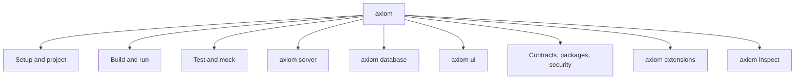

<span id="diagnose-and-begin" />
<span id="check-and-build-any-contract" />
<span id="additional-contract-tools" />
<span id="database-developer-commands" />
<span id="local-development" />
<span id="server-target-and-release-tooling" />
<span id="pull-a-client" />
<span id="contract-dependency-locks" />
<span id="typed-frontend-packages" />
<span id="acore-ui-applications" />
<span id="application-artifacts" />
<span id="install-or-run-the-language-server" />
<span id="cli-cache" />
<span id="exit-behavior-and-automation" />
<span id="source-owned-database-application-operations" />
<span id="approved-backend-interfaces" />
<span id="axiom-inspector-local-dashboard" />
<span id="contract-inspector" />
<span id="watch-display" />
<span id="cache-explorer" />
<span id="login-and-project-selection" />

The Axiom CLI (`axiom`) is the single command-line tool for AxiomCore. It
checks and builds Acore contracts, runs backends, frontends and databases
locally, inspects applications, manages extensions and packages, and publishes
releases to Axiom Cloud. This reference covers the released CLI **0.151.0**: 41
top-level commands and 356 commands and subcommands in total. Command pages
that were last checked against an earlier release say which one.

<StatusNote status="alpha" title="Axiom CLI">
  These commands are implemented in the current CLI, but names, flags, output
  schemas and connected-service requirements can change before a stable major
  release. Run `axiom --help` and `axiom <command> --help` for the version you
  installed. To install the CLI, see [Install the Axiom CLI](/getting-started/installation).
</StatusNote>



Most work happens offline on your machine. Setup commands prepare a repository
and an account. Build and run commands turn Acore source into contracts and
running services. The large namespaces (`server`, `database`, `ui`,
`extensions`, `inspect`) each have their own page. Only a few commands reach
Axiom Cloud; see [Cloud access and telemetry](#cloud-access-and-telemetry).

## Command pages

| Page | Commands |
| --- | --- |
| [Setup and project commands](/tooling/cli-project) | `init`, `onboard`, `doctor`, `login`, `join`, `project`, `install`, `cache`, `editor`, `lsp`, `repl`, `eval` |
| [Build and run commands](/tooling/cli-build-and-run) | `check`, `build`, `run`, `serve`, `watch`, `explain`, `diff`, `pull`, `package`, `release`, `deploy`, `migrate`, `benchmark` |
| [Test and mock commands](/tooling/cli-testing) | `test`, `scenario`, `mock` |
| [axiom server](/tooling/cli-server) | `server` and its 22 subcommands |
| [axiom database](/tooling/cli-database) | `database` and its subcommands |
| [Authentication commands](/tooling/cli-auth) | `auth` and its subcommands, in CLI 0.151.0 and later |
| [Branch commands](/tooling/cli-branch) | `branch` and its subcommands, in CLI 0.151.0 and later |
| [axiom ui](/tooling/cli-ui) | `ui` and its 16 subcommands |
| [Contract, package and security commands](/tooling/cli-contracts) | `contract`, `packages`, `dependencies`, `domain`, `security` |
| [axiom extensions](/tooling/cli-extensions) | `extensions` and its 19 subcommands |
| [axiom inspect](/tooling/cli-inspect) | `inspect` and its 46 subcommands |
| [Secrets commands](/tooling/secrets-cli) | `secrets`, in CLI 0.151.0 and later |

<span id="ui-host-commands" />

## All top-level commands

For `axiom secrets` (CLI 0.151.0 and later; not in 0.149.1), use the
[Secrets CLI reference](/tooling/secrets-cli). Protected runtime consumption of
secrets is **Experimental** and is not qualified with the published CLI. The
[Cloud Dashboard workflow](/cloud/secrets) is deployed as **Alpha**.

| Command | Purpose |
| --- | --- |
| [`axiom init`](/tooling/cli-project#axiom-init) | Create an `axiom.acore` source for a FastAPI or Go backend. |
| [`axiom onboard`](/tooling/cli-project#axiom-onboard) | Detect a repository's role and print or apply the shortest first path. |
| [`axiom doctor`](/tooling/cli-project#axiom-doctor) | Inspect local prerequisites without changing files, logging in or pulling. |
| [`axiom login`](/tooling/cli-project#axiom-login) | Sign in to Axiom Cloud with a device code. |
| [`axiom join`](/tooling/cli-project#axiom-join) | Join the Axiom Cloud waitlist. |
| [`axiom project`](/tooling/cli-project#axiom-project) | List, create, link and rotate keys for Cloud projects; resolve or package a local Acore project. |
| [`axiom install`](/tooling/cli-project#axiom-install) | Install the language server, an `.axiomapp`, or an extractor module. |
| [`axiom cache`](/tooling/cli-project#axiom-cache) | Browse, read or clear the CLI's local cache. |
| [`axiom editor`](/tooling/cli-project#axiom-editor) | Offline saved-source checks and editor compatibility metadata. |
| [`axiom lsp`](/tooling/cli-project#axiom-lsp) | Run the Acore language server over stdin and stdout. |
| [`axiom repl`](/tooling/cli-project#axiom-repl) | Start the Acore REPL. |
| [`axiom eval`](/tooling/cli-project#axiom-eval) | Evaluate an Acore file and print it as Acore, JSON, YAML or Markdown. |
| [`axiom check`](/tooling/cli-build-and-run#axiom-check) | Check a frontend, backend or database contract without writing outputs. |
| [`axiom build`](/tooling/cli-build-and-run#axiom-build) | Build a contract under `.axiom/contracts`, or export it with `--out`. |
| [`axiom run`](/tooling/cli-build-and-run#axiom-run) | Run a backend, frontend, database SQL console or packaged `.axiomapp`. |
| [`axiom serve`](/tooling/cli-build-and-run#axiom-serve) | Start the real local API; never falls back to mocks or Cloud. |
| [`axiom watch`](/tooling/cli-build-and-run#axiom-watch) | Watch for changes and rebuild or pull automatically. |
| [`axiom explain`](/tooling/cli-build-and-run#axiom-explain) | Print expanded backend JSON or the declaration catalog. |
| [`axiom diff`](/tooling/cli-build-and-run#axiom-diff) | Show what changed between Acore files or against the build baseline. |
| [`axiom pull`](/tooling/cli-build-and-run#axiom-pull) | Fetch a contract and generate a typed client. |
| [`axiom package`](/tooling/cli-build-and-run#axiom-package) | Combine target-specific `.axiomapp` builds into one artifact. |
| [`axiom release`](/tooling/cli-build-and-run#axiom-release) | Upload a backend contract to Axiom Cloud as an immutable version. |
| [`axiom deploy`](/tooling/cli-build-and-run#axiom-deploy) | Save a Cloud mock configuration for the linked project. |
| [`axiom migrate`](/tooling/cli-build-and-run#axiom-migrate) | Convert a legacy backend contract into a new sibling source. |
| [`axiom benchmark`](/tooling/cli-build-and-run#axiom-benchmark) | Measure local build and artifact-load times. |
| [`axiom test`](/tooling/cli-testing#axiom-test) | Run the test suites declared in a contract. |
| [`axiom scenario`](/tooling/cli-testing#axiom-scenario) | Validate and replay development scenarios against compiled artifacts. |
| [`axiom mock`](/tooling/cli-testing#axiom-mock) | Run server simulation or local or Cloud contract mocks. |
| [`axiom server`](/tooling/cli-server#axiom-server) | Scaffold, validate, run, package and verify server plans offline. |
| [`axiom database`](/tooling/cli-database#axiom-database) | Run and migrate versioned PostgreSQL and SQLite contracts. |
| [`axiom auth`](/tooling/cli-auth) | Administer project authentication: settings, providers, users and keys. |
| [`axiom branch`](/tooling/cli-branch) | Create, review and delete short-lived branch environments of a hosted database. |
| [`axiom secrets`](/tooling/secrets-cli) | Runtime secret sources and Cloud secret metadata. Values never enter compilation. |
| [`axiom ui`](/tooling/cli-ui#axiom-ui) | Advanced frontend tooling: hosts, packaging, tests and inspection. |
| [`axiom contract`](/tooling/cli-contracts#axiom-contract) | Resolve and verify signed contract dependencies for an Acore UI app. |
| [`axiom packages`](/tooling/cli-contracts#axiom-packages) | Build, resolve, verify, inspect and diff frontend `.axiom` packages. |
| [`axiom dependencies`](/tooling/cli-contracts#axiom-dependencies) | Resolve and audit third-party packages used by authored extensions. |
| [`axiom domain`](/tooling/cli-contracts#axiom-domain) | Validate or bootstrap the optional Domain Model layer. |
| [`axiom security`](/tooling/cli-contracts#axiom-security) | Analyze the opt-in security model without building. |
| [`axiom extensions`](/tooling/cli-extensions#axiom-extensions) | Build, sign, verify, inspect and review sandboxed extensions. |
| [`axiom inspect`](/tooling/cli-inspect#axiom-inspect) | Inspect an application workspace, contract or packaged application. |

## Global options

<span id="axiom-inspector" />

### axiom

The root command. It only dispatches to a subcommand.

```text title="Usage"
axiom <COMMAND>
```

| Option | Value | Default | Meaning |
| --- | --- | --- | --- |
| `-h, --help` | flag | off | Print help. Every command and subcommand accepts it. |
| `-V, --version` | flag | off | Print the CLI version. |

`axiom help [COMMAND]...` prints the same help as `--help`, for example `axiom
help database migrate`. There are no other global options: each command takes
its own options after its name. A few commands with long help, such as `axiom ui
inspect`, print a summary with `-h` and the full text with `--help`.

```bash title="Terminal"
axiom --version
```

```text title="Expected output"
axiom 0.151.0
```

## Exit codes

| Code | Meaning |
| --- | --- |
| `0` | The command succeeded. |
| `1` | The command failed. The CLI prints `Error:` and the cause on stderr. Failed checks also exit 1, for example `check`, `doctor --strict`, `database status --check`, a failing `test`, or `security check` with errors in strict mode. |
| `2` | The command line is invalid: an unknown command or option, or a missing required argument. Nothing ran. |

A few commands report findings but still exit 0 by design, for example
`axiom diff` and `security check` in audit mode. Use the gate the command offers,
such as `inspect diff --fail-on` or `security check --fail-on-warning`. A
non-zero exit is the command's result, not a guarantee that no remote state was
written before a later stage failed.

## Environment variables

| Variable | Read by | Effect |
| --- | --- | --- |
| `DATABASE_URL` | `run`, `database` | Default PostgreSQL or SQLite URL when no endpoint option is given. See [connection options](/tooling/cli-database#connection-options). |
| `PGPASSWORD`, `PGUSER`, `PGDATABASE` | `run`, `database` | PostgreSQL password, user and database when you use connection fields. `USER` is the last fallback for the user name. |
| `CI` | interactive commands | When set, prompts are skipped and commands that need an answer fail with the option to pass instead. |
| `AXIOM_REFERRAL_CODE` | Cloud commands | Referral code for the one-time [Cloud access check](#cloud-access-and-telemetry). In CI without it, a Cloud command exits 1. |
| `AXIOM_TELEMETRY` | Cloud commands | Exactly `0`, `false`, `FALSE`, `off` or `OFF` disables usage telemetry. |
| `AXIOM_CLOUD_URL` | Cloud commands | Reserved for local control-plane development. Accepts only `localhost` or a loopback IP, and selects a separate local profile. Leave it unset. |
| `AXIOM_FASTAPI_EXTRACTOR`, `AXIOM_GO_EXTRACTOR` | backend builds | Path to the FastAPI or Go extractor. Default: `~/.acore/bin/`. |
| `AXIOM_DATABASE_TRUSTED_KEY` | `database migrate`, `run` | When set, the migration release signer must match this key. |
| `AI_GATEWAY_API_KEY` | `inspect ask`, `inspect serve` | Key for the opt-in remote Jev question planner. |
| `AXIOM_UI_WEB_PORT`, `AXIOM_UI_WEB_NO_OPEN`, `AXIOM_UI_ANDROID_DEVICE_SERIAL`, `AXIOM_UI_NODE`, `AXIOM_UI_CACHE_ROOT`, `AXIOM_UI_DEBUG` | `ui`, `run` | Web port, browser opening, Android device, Node.js executable, UI cache location and debug output. See [axiom ui](/tooling/cli-ui#axiom-ui). |

`serve`, `run` and `server run` also read the provider values that your
deployment files name, such as `AXIOM_REDIS_URL` or `AXIOM_JWT_PUBLIC_KEY`. See
[axiom server](/tooling/cli-server#axiom-server-deployment).

<span id="cloud-projects-and-releases" />

## Cloud access and telemetry

Commands that use Axiom Cloud need network access. Most also need `axiom login`
and, for project operations, membership in the project.

| Needs Axiom Cloud | Commands |
| --- | --- |
| Sign-in (`axiom login` first) | `project list`, `project create`, `project link`, `project rotate-key`, `release`, `build --release`, `deploy mock-server`, `mock --cloud` |
| Network | `login`, `join`, `pull` of a remote contract, `watch` without `--build`, `onboard --contract`, `install NAME --module`, `project resolve`, `dependencies resolve`, `ui host install` (downloads a signed host) |
| Nothing remote | Everything else, including `check`, `build`, `serve`, `inspect`, `database`, `server` and `doctor`. `axiom run` of a frontend offers to download a missing UI Host, and the opt-in Jev planner of `inspect ask` and `inspect serve` is remote. |

**One-time access check.** Axiom Cloud is in private alpha. The first time you
run a command that is not on the local list (for example `login`, `project`,
`release`, `pull` of a remote contract, `cache`, or `install NAME --module`),
the CLI asks once for a referral code, or reads `AXIOM_REFERRAL_CODE`, and
registers the machine. Without a code, use [`axiom join`](/tooling/cli-project#axiom-join)
to join the waitlist. Local commands never ask.

**Telemetry.** After a command that passed the access check, the CLI sends one
usage record: a random machine ID, the command name, duration, success, an
error category, the OS and the CLI version. It never sends arguments, file
paths, URLs, credentials or contract and project names. Set `AXIOM_TELEMETRY=0`
to turn it off; only `0`, `false`, `FALSE`, `off` and `OFF` are recognized.
Local commands send nothing.

## Files and directories

| Location | Contents |
| --- | --- |
| CLI profile directory: `axiom` inside the OS configuration directory (for example `~/Library/Application Support/axiom` on macOS, `~/.config/axiom` on Linux) | `auth.json` (Cloud session and directory-to-project links), `access.json` (access registration and machine ID), `cache/` (the [`axiom cache`](/tooling/cli-project#axiom-cache) store). Owner-only permissions on Unix. |
| `~/.axiom/bin/` | `acore-lsp` from `axiom install lsp-server`. |
| `~/.acore/bin/` | Backend extractors. |
| `.axiom/` in each project root | Generated, CLI-owned state: `contracts/` (build output), `baselines/` (diff baselines), `dev/` (development locks), `database/` (version catalog, default SQLite data, development key), `inspector/` (snapshots and runtime sessions). |

A project root is the nearest directory with an `AxiomDeps.toml`. Do not edit
`.axiom/` by hand; commit the source files and the locks your workflow reviews.

## Terminal interfaces

Some commands draw a keyboard interface when attached to a terminal. In CI, use
their headless or JSON alternatives.

| Command | Interface | Keys |
| --- | --- | --- |
| `axiom inspect FILE.axiom` (backend contract) | Single-contract inspector with endpoint and model views. | `Tab` switches views, `j`/`k` or arrows move, `q` or `Esc` exits. |
| `axiom watch --build` | Rebuild state, last sync time and semantic changes. | `r` refreshes, `q` or `Esc` stops. |
| `axiom watch` | Contract changes after a pull. | `q` stops. |
| `axiom cache ls` | Cache explorer. | `j`/`k` or arrows move, `x` deletes the entry, `q` or `Esc` exits. |
| `axiom init` | Setup wizard. | Arrows and Enter; `Esc` or Ctrl+C leaves. |
| `axiom login` | Device code and approval status. | Waits for the browser flow. |
| `axiom project link`, `release` | Project picker and version prompt. | Pass `--project-id`, `--project` or `--version` in automation. |

The contract inspector needs a terminal: without one it fails. For scripts, use
`axiom inspect overview` or another [`axiom inspect`](/tooling/cli-inspect)
subcommand with `--format json`. Its search field is not part of the keyboard
contract. For a whole application, use the browser-based
[`axiom inspect serve`](/tooling/cli-inspect#axiom-inspect-serve) dashboard,
which binds to loopback with a per-session token.

<StatusNote status="alpha" title="Terminal interface stability">
  Layouts and key hints can change with the CLI. The command result and the
  written artifact or Cloud record are the durable boundary, not the screen.
</StatusNote>

## Automation rules

- Use `--json` or `--format json` only where a command offers it, and do not
  parse human or styled output.
- Use non-interactive options (`--non-interactive`, `--project`, `--version`,
  `--project-id`) and pinned inputs and locks in CI.
- Gate on the exit code, then read the machine output.
- Keep the private files that commands write (plans, deployments, keys,
  development credentials) out of source control.
