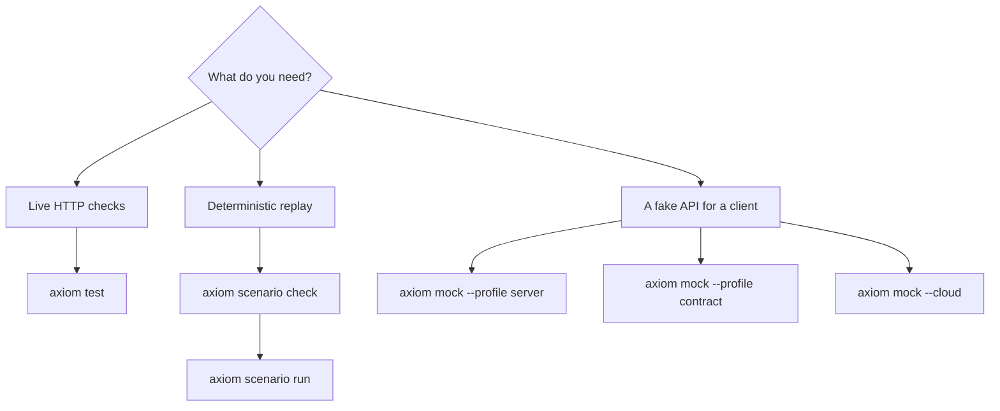

These commands test a backend contract without production providers: `axiom
test` runs the HTTP checks declared in the contract, `axiom scenario` replays
scripted development scenarios against exact compiled artifacts, and `axiom
mock` serves simulated responses. This page covers Axiom CLI 0.149.1.

| Command | Status | Needs |
| --- | --- | --- |
| `axiom test` | Alpha | A running service at each suite's `baseUrl`. |
| `axiom scenario` | Experimental | A compiled contract and private server plan. No listener or network. |
| `axiom mock` (local) | Alpha | Nothing remote. Server profiles need a private plan and fixtures. |
| `axiom mock --cloud` | Alpha | Network, `axiom login` and a linked Cloud project. |



Use `axiom test` against a running service. Use `axiom scenario` for
logical-time replay of managed actions with no listener. Use `axiom mock` when a
client needs an API to call: the server profile runs through the real server
boundary with private fixtures, the contract profile serves endpoint scenarios,
and `--cloud` serves the mock configuration stored in Axiom Cloud. Guides:
[Contract tests](/testing/contracts), [Mocks](/testing/mocks) and
[Server simulation](/testing/server-simulation).

## Run contract test suites

### axiom test

Run the test suites declared in the contract's `testConfig`. Each check sends a
real request to its suite's `baseUrl`, so start the service first.

```text title="Usage"
axiom test [OPTIONS] [FILE]
```

| Option | Value | Default | Meaning |
| --- | --- | --- | --- |
| `[FILE]` | path | `axiom.acore` | Backend `.acore` file that declares `testConfig`. |
| `--tag` | text | none | Run only suites that carry this tag. With no match, the command prints a notice and exits 0. |
| `--variant` | name | none | Contract variant used to resolve endpoint references. |

Checks can select a contract route or an explicit URL, send request inputs,
assert status, duration, schema, body and headers, and capture response values.
A WebSocket endpoint uses its declared WebSocket contract. A failed check exits
1. Without `testConfig`, the command fails and shows the declaration to add.

<Callout type="warn" title="Real requests">
  Checks can perform real network writes. Verify each suite's `baseUrl` and
  credentials before you run it.
</Callout>

```bash title="Terminal"
axiom test axiom.acore --tag auth-critical
```

## Replay development scenarios

<StatusNote status="experimental" title="Development scenarios">
  Scenarios are development-only. The `native-managed.v1` fixture runs compiled
  managed query actions with synthetic read providers and logical time. It
  rejects UI interactions, state selectors, write providers and native or
  sandbox bodies before activation.
</StatusNote>

### axiom scenario

Validate and replay development scenarios against exact compiled artifacts.

```text title="Usage"
axiom scenario <COMMAND>
```

| Subcommand | Purpose |
| --- | --- |
| [`catalog`](#axiom-scenario-catalog) | Describe typed operations and exact artifact identities. |
| [`check`](#axiom-scenario-check) | Validate every step without running application code. |
| [`run`](#axiom-scenario-run) | Run the scenario with logical time and strict scripts. |

All three take the compiled backend contract and its private server plan. `axiom
build` writes both: the contract under `.axiom/contracts/` and the
`backend.server.json` plan beside it. Contract and plan files are limited to 16
MiB.

### axiom scenario catalog

Describe the typed operations, declared failures, supported controls and exact
artifact identities, without executing anything. Copy its `artifacts` object
into your scenario file.

```text title="Usage"
axiom scenario catalog [OPTIONS] --plan <PLAN> <CONTRACT>
```

| Option | Value | Default | Meaning |
| --- | --- | --- | --- |
| `<CONTRACT>` | path | required | Compiled backend `.axiom` contract. |
| `--plan` | path | required | Private server plan for that contract. |
| `--environment` | path | none | Synthetic expiry environment (`axiom-scenario-environment/v1`). Adds the environment digest to `artifacts`. |

```bash title="Terminal"
axiom scenario catalog .axiom/contracts/backend.axiom --plan .axiom/contracts/backend.server.json
```

### axiom scenario check

Validate every scripted value and assertion against the catalog. It acquires no
resources and does not invoke application code.

```text title="Usage"
axiom scenario check [OPTIONS] --plan <PLAN> --scenario <SCENARIO> <CONTRACT>
```

| Option | Value | Default | Meaning |
| --- | --- | --- | --- |
| `<CONTRACT>` | path | required | Compiled backend `.axiom` contract. |
| `--plan` | path | required | Private server plan. |
| `--scenario` | path | required | Scenario JSON file. |
| `--environment` | path | none | Synthetic expiry environment, when the scenario was written against one. |

On success it prints `axiom-development-scenario-check/v1` JSON with
`"validated": true`, `"executed": false` and the scenario hash.

### axiom scenario run

Run the scenario through the native managed query fixture, with logical time and
strict scripts. It opens no listener and uses no external provider or live
credential.

```text title="Usage"
axiom scenario run [OPTIONS] --plan <PLAN> --deployment <DEPLOYMENT> --scenario <SCENARIO> <CONTRACT>
```

| Option | Value | Default | Meaning |
| --- | --- | --- | --- |
| `<CONTRACT>` | path | required | Compiled backend `.axiom` contract. |
| `--plan` | path | required | Private server plan. |
| `--deployment` | path | required | Reviewed deployment. Scenario data cannot grant permissions or create a principal. |
| `--scenario` | path | required | Scenario JSON file. |
| `--environment` | path | none | Reviewed, development-only synthetic expiry environment; no live credentials. It sets the clock epoch and seed, so it conflicts with `--epoch-ms` and `--seed`. |
| `--epoch-ms` | milliseconds | `0` | Synthetic wall-clock epoch. |
| `--seed` | number | `7` | Test-only policy jitter seed. It never replaces secure randomness. |
| `--report` | path | none | Save the bounded, payload-free report, including on assertion failure. |
| `--observations` | path | none | Save payload-free host observations, labeled `scripted-provider`. |

Reports use `axiom-development-scenario-report/v1` and label the executed level
`compiler-host`. Unexpected calls, unused replies, stale artifacts, zero
assertions and leaked owners fail the run. Cleanup also runs after a failed
assertion, and Ctrl+C cancels owned work and still writes `--report`.

```bash title="Terminal"
axiom scenario run backend.axiom --plan backend.server.json \
  --deployment deployment.json --scenario retry.scenario.json \
  --epoch-ms 0 --seed 7 --report retry.report.json
```

## Serve mock APIs

### axiom mock

Run an isolated server simulation, a local contract mock, or a Cloud contract
mock. It never starts real business execution and never uses production
providers.

```text title="Usage"
axiom mock [OPTIONS] [INPUT]
```

| Option | Value | Default | Meaning |
| --- | --- | --- | --- |
| `[INPUT]` | path | `axiom.acore` | `.acore` source or compiled `.axiom` artifact. |
| `--profile` | `auto`, `server`, `contract` | `auto` | Simulation profile. See the table below. |
| `--fixtures` | path | adjacent `mock.json` | Private typed fixtures for the server profile. |
| `--identities` | path | adjacent `mock-identities.json` | Reviewed mock identities. |
| `--plan` | path | adjacent `<name>.server.json` | Exact private plan. Artifact input only. |
| `--variant` | name | `default` | Source variant to compile. Rejected for an artifact, whose variant is immutable. |
| `--watch` | flag | off | Reload source and fixtures, keeping the last valid session. Source input only. |
| `--host` | IP address | `127.0.0.1` | Listener address. |
| `-p, --port` | number | `8080` | Listener port. `0` selects an ephemeral port, except with `--watch`. |
| `-d, --debug` | flag | off | Redacted diagnostics. Never prints raw credentials or bodies. |
| `--cloud` | flag | off | Serve Cloud contract mocks. Needs network, `axiom login` and a linked project. |
| `--deployment` | path | none | Rejected in mock mode: a real deployment is never reused. |
| `--bindings` | path | none | Rejected in mock mode. |
| `--delivery` | path | none | Rejected in mock mode. |

| Profile | Selected when | Behavior |
| --- | --- | --- |
| `server` | The input has a compiled private server plan (`auto` picks it). | Full simulation inside the real server boundary. Keeps action guards and supported transport enforcement. Requires `--fixtures` or an adjacent `mock.json`. |
| `contract` | The input has no server plan (`auto` picks it). | Endpoint scenarios from the contract. Rejects an input with a server plan, and rejects `--fixtures` and `--identities`. |
| Cloud | `--cloud` | Contract mocks stored in Axiom Cloud, with cache and ETag retrieval. Conflicts with every local input, `--variant` and `--watch`, and supports only the contract profile. |

A successful source reload with `--watch` resets simulation state and issues
fresh credentials. A rejected reload keeps the last valid session. Input files
must be regular files no larger than 16 MiB.

```bash title="Terminal"
axiom mock axiom.acore --profile server --fixtures mock.json
axiom mock api.acore --profile contract
axiom mock --cloud
```

To publish the Cloud mock configuration, use
[`axiom deploy mock-server`](/tooling/cli-build-and-run#axiom-deploy-mock-server).
To run the same simulation through `axiom serve`, see
[`axiom serve --mock`](/tooling/cli-build-and-run#axiom-serve).
